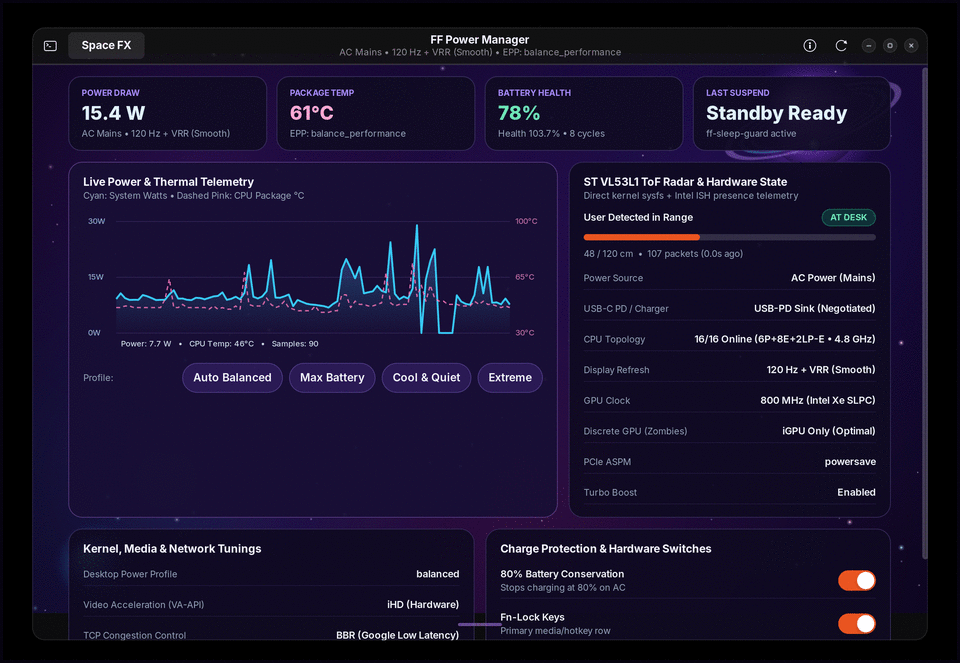
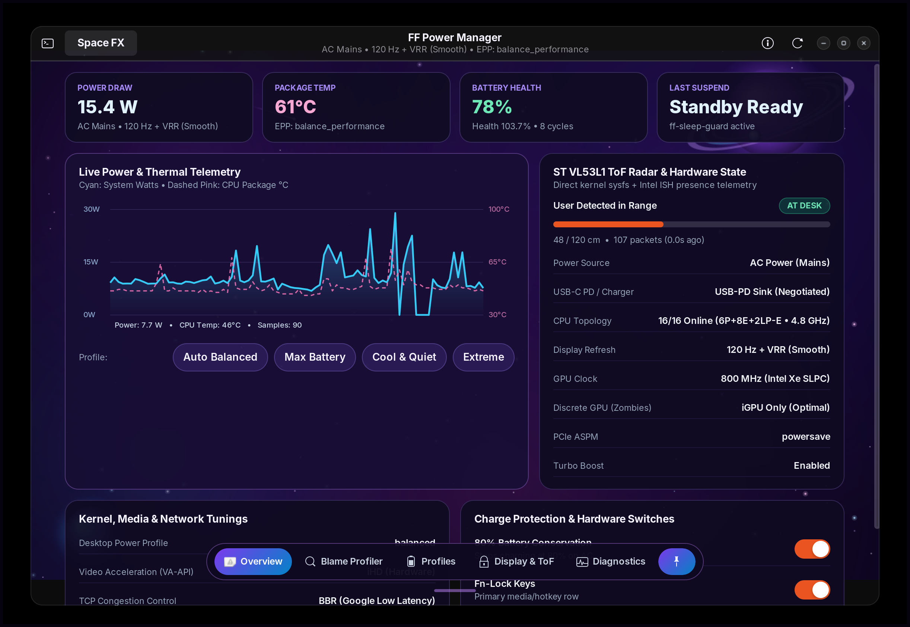
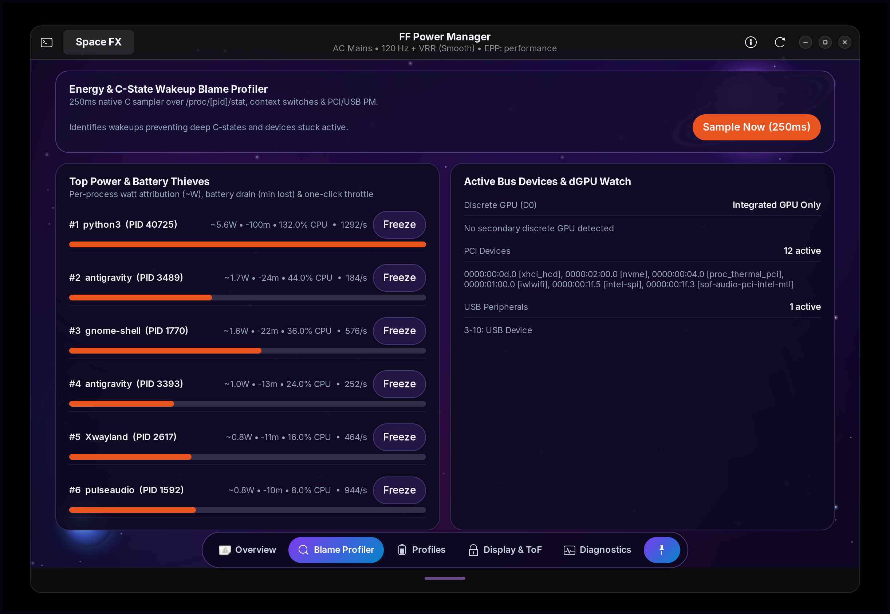
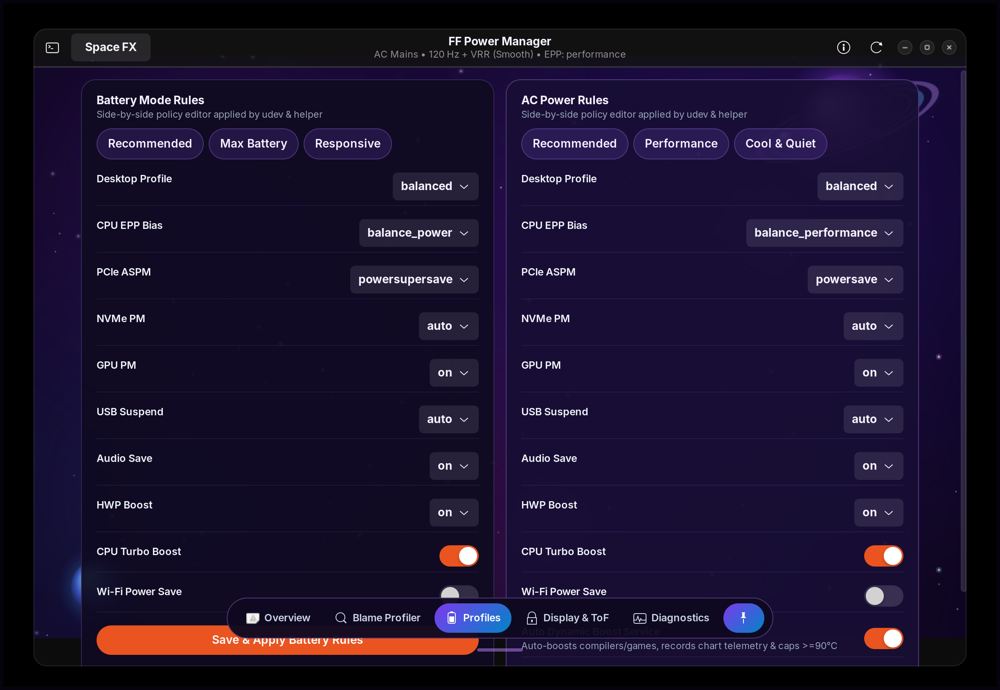
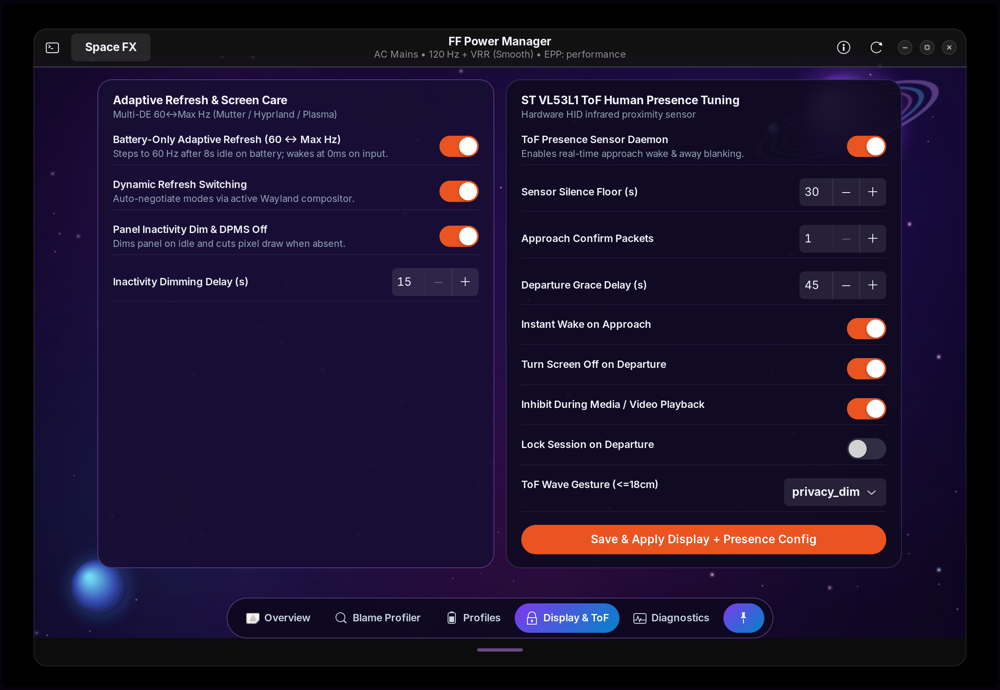

# FF Power Manager v2.2

[](LICENSE)
[](https://github.com/lwrlock/ff-power-manager/releases/tag/v2.2.0)

[ English | [Türkçe](README.tr.md) ]

Linux laptop power profile manager with adaptive refresh rate switching (`60↔Max Hz`), per-process wakeup/drain profiling (`ffctl blame`), `s2idle` standby drain measurement (`ffctl sleep-report`), optional ToF presence detection, and a GTK4 UI.

Built with a C and x86_64 Assembly telemetry core (`ffctl`, `ff-tui`, `ff-presence-sensor`) paired with Python, GTK4, and Wayland/DBus integration for Intel and AMD laptops (Ubuntu, Debian, Fedora).

<p align="center">
  
</p>

<details>
<summary>Screenshots (overview, blame, profiles, display)</summary>

| Telemetry Overview | Power Blame & Process Freeze |
| :---: | :---: |
|  |  |

| Battery & AC Profiles | Display & ToF Gestures |
| :---: | :---: |
|  |  |

</details>

---

## Comparison with TLP / auto-cpufreq

| Feature | TLP / auto-cpufreq | FF Power Manager v2.2 |
| :--- | :---: | :---: |
| Hybrid P/E/LP-E & symmetric CPU topology discovery | Partial | `detect_cpu_topology()` + `cpuinfo_max_freq` clamping |
| Per-process CPU & wakeup blame (`ffctl blame`) | Separate (`powertop`) | Built-in 250ms C procfs sampler + PCI/USB blocker scan |
| Sleep & residency audit (`ffctl doctor`) | No | Checks `s2idle`, ACPI wakeups, PCI PM ratio, service conflicts |
| Suspend drain measurement (`ffctl sleep-report`) | No | Logs pre/post-sleep `energy_now` (`Wh`, `W`, `%/hr`) |
| JSON CLI output (`--json`) | Limited | Supported across `status`, `health`, `doctor`, `blame`, `sleep-report` |
| Battery-only adaptive refresh (`60↔Max Hz`) | No | GNOME (`Mutter`), Hyprland (`hyprctl`), KDE (`kscreen-doctor`) |
| ToF presence sensor integration (Intel ISH HID) | No | C / x86_64 ASM `hidraw` parser + MPRIS/PCM lock |
| Thermal cap (`>=90°C`) & one-shot 100% charge | No | RAPL clamping + auto-rearming 80% conservation limit |
| Privilege model | Root daemon | Non-setuid `ffctl` + scoped PolicyKit `ff-power-helper` |

---

## Architecture

```
  [ST VL53L1 ToF HID] ──► ff-presence-sensor (C + x86_64 ASM) ──► /run/ff-power-manager/*
                                                                          │
  [GNOME Mutter / Hyprland / Plasma] ◄── ff-presence-session ◄────────────┤
  [/proc/[pid] + /proc/stat + hwmon] ───► ff-power-autoboost ──► core.py + telemetry_history.json
  [systemd-sleep pre/post]           ───► ff-sleep-guard     ──► /var/lib/ff-power-manager/last_sleep.json
  [Cosmic GTK4 UI / Waybar / ffctl]  ───► ff-power-helper (PolicyKit, zero setuid root binaries)
```

---

## Features (v2.2.0)

- **Process Blame (`ffctl blame [--json]`):** Samples `/proc/[pid]/stat` and RAPL/battery counters in 250ms C intervals, scans PCI/USB runtime PM blockers (`D0` vs `D3cold`), and lets you throttle background apps via `ffctl throttle` or the GTK4 UI.
- **USB-C PD & Diagnostics (`ffctl setup`, `ffctl bundle`):** Reads negotiated USB-PD Volts/Amps/Watts, flags `<45W` chargers, applies hardware-specific defaults (`ffctl setup --apply`), and bundles sanitized `.tar.gz` logs for bug reports.
- **GTK4 Desktop App (`ff-power-manager`):** Hardware-accelerated GTK4/Cairo interface with power profiles, live wattage/temp sparkline, process blame tab, and optional ToF proximity gestures (`<=18cm`).
- **Suspend Drain Reporting (`ffctl sleep-report [--json]`):** `ff-sleep-guard` disables unneeded USB/Thunderbolt wakeups pre-suspend and records exact `Wh`, `W`, and `%/hr` standby loss upon resume.
- **Residency Check (`ffctl doctor [--json]`):** Verifies `s2idle`/`deep` hooks, `/proc/acpi/wakeup` state, PCI Runtime PM ratios, P-state/EPP drivers, and conflicts with `tlp` or `auto-cpufreq`.
- **Adaptive Refresh & Focus Throttling:** Lowers refresh rate on idle while on battery across GNOME (`Mutter`), Hyprland (`hyprctl`), and KDE Plasma (`kscreen-doctor`), and deprioritizes unfocused browser/Electron processes on battery.
- **Waybar & Distro Packaging:** Includes a JSON Waybar module ([contrib/waybar/](contrib/waybar/README.md)), `build-deb.sh`, and an RPM spec ([packaging/ff-power-manager.spec](packaging/ff-power-manager.spec)).

---

## Hardware Compatibility Matrix

| Hardware / Feature | Discovery / Sysfs Path | Status |
| :--- | :--- | :---: |
| **Intel Core Ultra (Arrow/Meteor/Lunar Lake)** | `intel_pstate`, `intel-rapl`, hybrid `P+E+LP-E` `cpuinfo_max_freq` | **Verified Bare-Metal** |
| **AMD Ryzen Mobile** | `amd-pstate-epp`, `k10temp` / `zenpower`, `pp_dpm_sclk` | **Universal Discovery** |
| **Intel Xe / i915 & AMD Radeon iGPU** | `tile*/gt*/freq0`, `gt_min_freq_mhz`, `pp_dpm_sclk`, Mesa/iHD VA-API | **Supported** |
| **Charge Conservation (80% + One-Shot 100%)** | Lenovo `VPC2004/conservation_mode` & generic `charge_control_end_threshold` | **Verified Bare-Metal** |
| **ST VL53L1 ToF Human Presence (Intel ISH)** | `/dev/hidraw*` (`8087:0AC2`, 35-byte Report 4) | **Optional Auto-Detected** |

---

## Installation

### Option 1: `.deb` Package (Ubuntu / Debian)
Download `ff-power-manager_2.2.0_amd64.deb` from [Releases](https://github.com/lwrlock/ff-power-manager/releases) and run:
```bash
sudo apt install ./ff-power-manager_2.2.0_amd64.deb
```

### Option 2: Build & Install from Source (Ubuntu / Debian / Fedora)
```bash
git clone https://github.com/lwrlock/ff-power-manager.git
cd ff-power-manager
sudo ./install.sh
```

Or build packages locally:
```bash
bash build-deb.sh          # Produces dist/ff-power-manager_2.2.0_amd64.deb
# Fedora RPM spec: packaging/ff-power-manager.spec
```

---

## Usage

```bash
ffctl status [--json]        # Live wattage, temp, CPU cap, EPP, ARR Hz & ToF state
ffctl doctor [--json]        # Hardware residency, PCI PM, ACPI wakeups & conflict audit
ffctl blame [--json]         # Top CPU/wakeup processes + active PCI/USB hardware blockers
ffctl sleep-report [--json]  # Last s2idle/deep suspend duration, Wh and W standby draw
ffctl health [--json]        # Factory design capacity, full Wh, cycle count & health %
ffctl apply [profile]        # Apply battery|ac|extreme_performance|cool_quiet|max_battery
ffctl conservation on|off    # Toggle 80% battery conservation threshold
ffctl benchmark              # Benchmark native C + x86_64 assembly sysfs read latency
```

Launch interactive UIs anytime: `ff-power-manager` (GTK4 App) or `ff-tui` (Terminal Dashboard).

---

## Contributing

Found an issue or hardware quirk on a ThinkPad, IdeaPad, Framework, ASUS, or AMD laptop? Open an [Issue](https://github.com/lwrlock/ff-power-manager/issues) with the output of `ffctl doctor --json` and `ffctl blame --json`.

## Related Tools

- [ebpf-latency-guard](https://github.com/lwrlock/ebpf-latency-guard) — PSI, `schedstat`, `/proc/interrupts` sampler + `sched_wakeup`/`sched_switch` eBPF program
- [vram-atlas](https://github.com/lwrlock/vram-atlas) — DRM GPU (`xe`/`amdgpu`), Intel NPU (`intel_vpu`), UMA memory & `llama.cpp` `/metrics` monitor
- [waylens-privacy](https://github.com/lwrlock/waylens-privacy) — USB HID/storage baseline monitor, ToF lock helper, `ssh-add -D` & SHA-256 audit log
- [mempulse](https://github.com/lwrlock/mempulse) — MGLRU `lru_gen`, `zram0` compression & memory PSI monitor
- [netpulse-bpf](https://github.com/lwrlock/netpulse-bpf) — Interface rate, TCP BBR/`fq`, `/proc/net/snmp` retransmit & socket monitor + `sock_ops` eBPF hook
- [nvme-sentinel](https://github.com/lwrlock/nvme-sentinel) — NVMe `hwmon` thermal, PCIe link, APST latency & `/sys/block/nvme*` IOPS monitor

## License & Development

MIT License. Copyright (c) 2026 Furkan (**lwrlock**). See [LICENSE](LICENSE). Built with AI coding assistance (Google DeepMind Antigravity) and tested directly on bare-metal Linux hardware.
