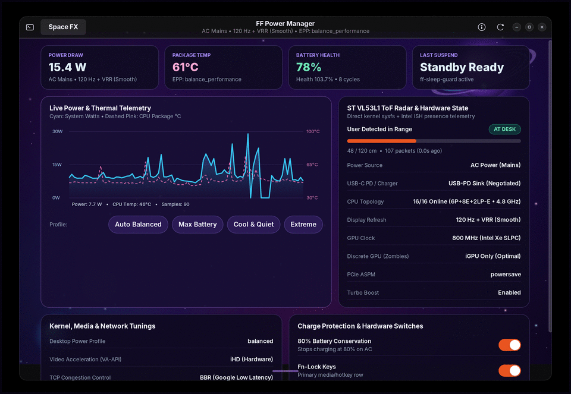
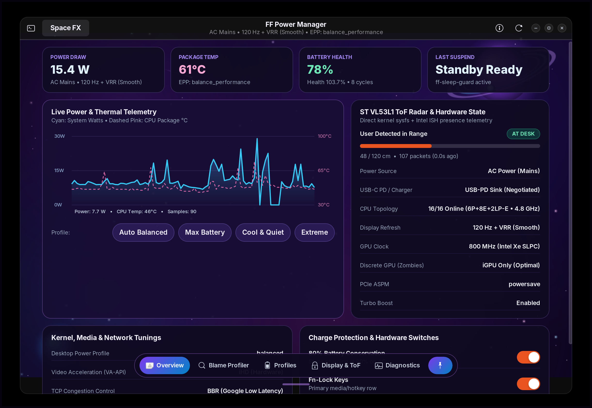
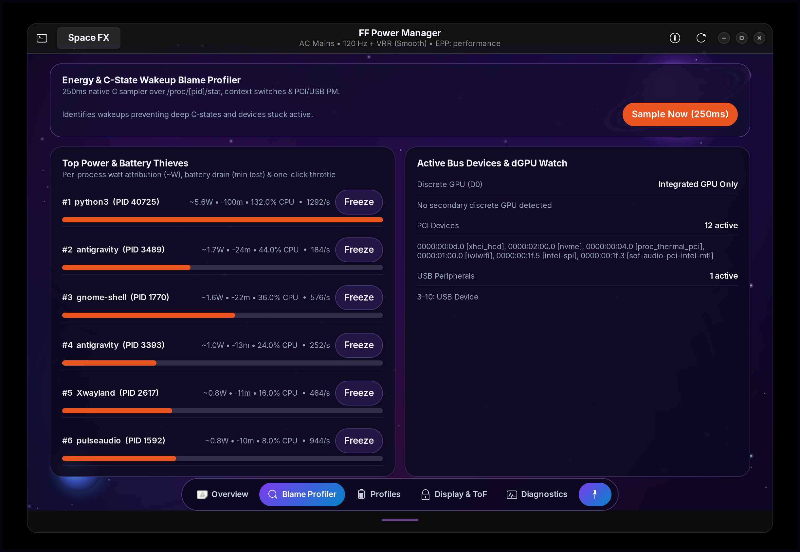
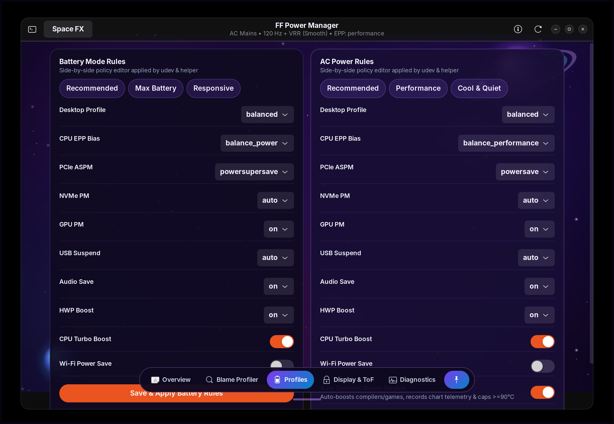
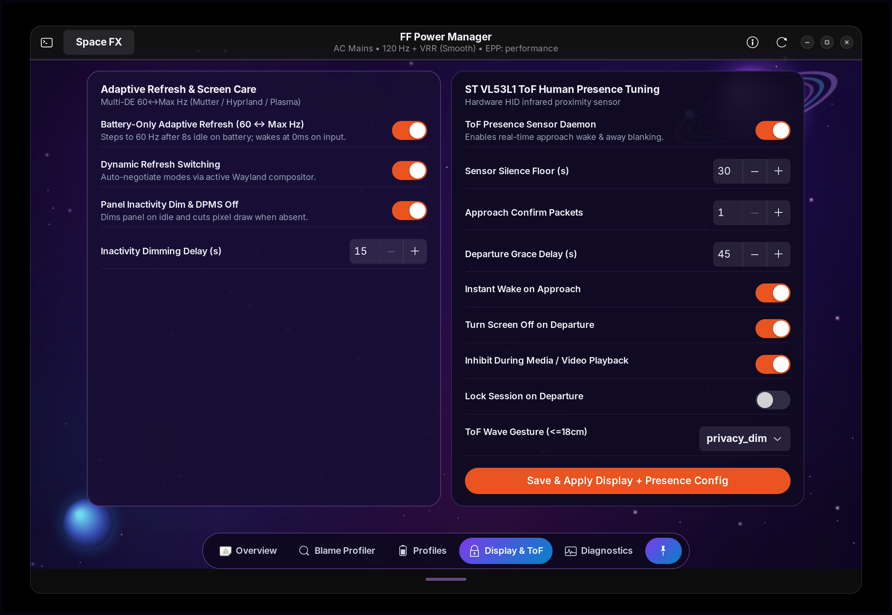

# FF Power Manager v2.2

[](LICENSE)
[](https://github.com/lwrlock/ff-power-manager/releases/tag/v2.2.0)

[ [English](README.md) | Türkçe ]

Linux dizüstü bilgisayarlar için güç profili yöneticisi, adaptif ekran yenileme (`60↔Max Hz`), süreç bazlı güç/uyanma analizi (`ffctl blame`), `s2idle` uyku tüketim raporu (`ffctl sleep-report`), isteğe bağlı ToF varlık sensörü desteği ve GTK4 arayüzü.

<p align="center">
  
</p>

<details>
<summary>Ekran görüntüleri (genel bakış, blame, profiller, ekran)</summary>

| Genel Bakış | Süreç Tüketimi & Kısıtlama |
| :---: | :---: |
|  |  |

| Pil & Priz Profilleri | Adaptif Yenileme & ToF |
| :---: | :---: |
|  |  |

</details>

## v2.2.0 Özellikleri

- **GTK4 Masaüstü Uygulaması (`ff-power-manager`):** Güç profilleri, canlı Watt/sıcaklık grafiği, süreç tüketim sekmesi ve isteğe bağlı ToF yakınlık/el hareketi (`<=18 cm`) desteği.
- **Süreç Tüketimi ve Kısıtlama (`ffctl blame`, `ffctl throttle`):** 250 ms aralıkla `/proc/[pid]/stat` ve RAPL/pil sayaçlarını okuyarak süreçlerin tahmini Watt tüketimini ve pil süresine etkisini hesaplar, PCI/USB güç engelleyicilerini (`D0` / `D3cold`) tarar ve arka plan uygulamalarını kısıtlamayı sağlar.
- **USB-C PD & Tanılama (`ffctl setup`, `ffctl bundle`):** Bağlı USB-PD adaptörünün Volt/Amper/Watt değerini okur (`<45W` uyarısı dahil), donanıma uygun varsayılanları uygular (`setup --apply`) ve hata bildirimi için arındırılmış `.tar.gz` paketi (`bundle`) üretir.
- **Uyku Tüketim Raporu (`ffctl sleep-report [--json]`):** `ff-sleep-guard` uyku öncesi gereksiz USB/Thunderbolt uyandırmalarını devre dışı bırakır ve uyanışta kaybedilen `Wh`, `W` ile `%/saat` değerlerini kaydeder.
- **Adaptif Yenileme & Odak Kısma:** Pildeyken boşa çıkınca GNOME (`Mutter`), Hyprland (`hyprctl`) ve KDE Plasma (`kscreen-doctor`) üzerinde ekran yenileme hızını düşürür; odakta olmayan ağır tarayıcı/Electron süreçlerinin önceliğini azaltır.
- **Waybar & Paketleme:** [contrib/waybar/](contrib/waybar/README.md) modülü, `build-deb.sh` ve Fedora RPM spec ([packaging/ff-power-manager.spec](packaging/ff-power-manager.spec)) dahildir.

## Kurulum

```bash
# Ubuntu / Debian .deb paketi:
sudo apt install ./ff-power-manager_2.2.0_amd64.deb

# Veya kaynaktan kurulum (Ubuntu / Debian / Fedora):
git clone https://github.com/lwrlock/ff-power-manager.git
cd ff-power-manager
sudo ./install.sh
```

## Lisans ve Geliştirme

MIT — ayrıntılar için [LICENSE](LICENSE). Furkan (`@lwrlock`) tarafından yapay zeka kodlama desteği (Google DeepMind Antigravity) ile geliştirildi ve gerçek Linux donanımı üzerinde test edildi.
